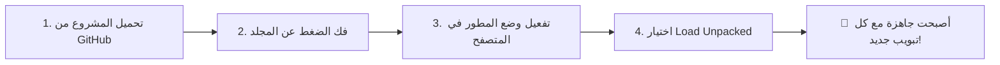

# 🕌 اللوحة الذكية - صفحة تبويب جديدة | New Tab Smart

  <b>إضافة المتصفح الإسلامية والذكية الأكثر تكاملاً وفخامة لتخصيص صفحة التبويب الجديدة (New Tab)</b> 
  لوحة شاملة تجمع بين مواقيت الصلاة الدقيقة، تدبر القرآن، الأذكار والمسبحة، مؤقت التركيز (بومودورو)، الطقس، أدوات الذكاء الاصطناعي، والمهام اليومية بتصميم ملكي عصري.

[العربية](#-عن-المشروع) • [English Summary](#-english-overview) • [المميزات](#-أبرز-المميزات) • [طريقة التركيب](#-طريقة-التركيب-والتثبيت) • [الاختصارات](#-اختصارات-لوحة-المفاتيح) • [المطور](#-المطور-والمساهمة)

---

## 📖 عن المشروع

**New Tab Smart (اللوحة الذكية)** هي إضافة مفتوحة المصدر لمتصفحات الويب الحديثة (Google Chrome, Microsoft Edge, Brave, Opera, وغيرها) تحوّل صفحة البداية الفارغة إلى واجهة ذكية، هادئة، ومفعمة بالإنتاجية والروحانية.

صُممت الإضافة لتكون **خفيفة جداً، سريعة الاستجابة، وتحترم خصوصيتك بنسبة 100%**؛ حيث تعمل بدون أي خوادم تتبع أو إعلانات، وتعمل بالكامل داخل جهازك مع تخزين محلي لبياناتك وإمكانية حفظ واسترجاع النسخ الاحتياطية بنقرة واحدة.

---

## ✨ أبرز المميزات

### 1. 🕋 مواقيت الصلاة الدقيقة والعد التنازلي
- حساب دقيق لمواقيت الصلوات الخمس مع وقت الشروق.
- عد تنازلي حي للصلاة القادمة مع بيان الوقت المنقضي منذ آخر صلاة.
- شريط مرئي يعرض أوقات الصلوات كاملة ونسبة التقدم في اليوم.
- دعم أشهر طرق الحساب العالمية: (أم القرى، رابطة العالم الإسلامي، الهيئة العامة المصرية، جامعة العلوم الإسلامية بكراتشي، الاتحاد الإسلامي لأمريكا الشمالية ISNA، وغيرها) مع إمكانية التعديل اليدوي للزوايا وفروق الدقائق.
- تنبيهات الأذان مع إمكانية رفع صوت أذان وتكبير مخصص وتشغيل إشعارات سطح المكتب (Desktop Notifications).
- تذكير قبل الصلاة، تذكير بعد الصلاة، وتنبيه على رأس كل ساعة بنغمات مخصصة.

### 2. 📖 تدبر القرآن الكريم وسورة الكهف
- **تَدَبُّر آية يومي**: آية مختارة مع التفسير المختصر والفوائد الإيمانية والترجمة، مع إمكانية الاستماع المباشر بصوت عذب.
- **زر سورة الكهف المخصص**: تذكير نبضي ذكي يوم الجمعة، مع نافذة قراءة واستماع صوتي مدمج تدعم عدة مشايخ وقراء مع التحكم بالصوت والتقديم.

### 3. 📿 الأذكار والمسبحة الإلكترونية المتطورة
- بطاقة الذكر السريع المتجدد مع بيان فضله وأجره.
- مسبحة رقمية متطورة تدعم التسبيح بالنقرات واختصارات الكيبورد (المسافة أو الأرقام).
- أهداف تسبيح قابلة للتخصيص (33، 100، أو أرقام حرة) مع تنبيهات صوتية عند بلوغ الهدف.
- إحصائيات يومية وفترات التسبيح المحفوظة محلياً.
- نافذة مخصصة لأذكار الصباح، أذكار المساء، وأذكار ما بعد الصلاة.

### 4. 🍅 مؤقت بومودورو ووضع التركيز الفائق (Focus Mode)
- مؤقت بومودورو مدمج في الواجهة مع حلقة تقدم دائرية لمتابعة فترات العمل والاستراحة.
- **وضع التركيز الموسّع للشاشة الكاملة (Focus Overlay)**: واجهة هادئة خالية من أي مشتتات لإنجاز مهامك بكفاءة، مع عداد وإحصائيات لجلسات ودقائق التركيز المنجزة.

### 5. 🌤️ الطقس وتوقعات الأيام السبعة
- عرض درجة الحرارة الحالية، حالة الطقس، نسبة الرطوبة، وسرعة الرياح.
- بطاقة توقعات لـ 7 أيام قادمة مع أيقونات بصرية واضحة.
- بحث جغرافي ذكي وسريع لتحديد مدينتك أو أي مدينة حول العالم بسهولة.

### 6. 🕰️ الساعة والتاريخ المزدوج وعداد رمضان
- ساعة رقمية أنيقة مع خيارات تخصيص واسعة (نظام 12/24 ساعة، أرقام عربية مشرقية أو لاتينية).
- ساعة تناظرية كلاسيكية مع عقارب حركة انسيابية.
- ميزة مكافحة تطبيع الشاشات (Burn-in Protection).
- عرض التاريخ الهجري المعتمد والتاريخ الميلادي واسم اليوم مع إمكانية ضبط اليوم الهجري (+/- يومين).
- **عدّاد تنازلي لأيام شهر رمضان المبارك**.

### 7. 🤖 منصات الذكاء الاصطناعي وشريط التطبيقات
- رصيف (Dock) عائم وسريع لأبرز منصات الذكاء الاصطناعي: ChatGPT, Claude, Gemini, DeepSeek, Perplexity, وغيرها.
- شريط للمواقع الاجتماعية والمفضلة الأكثر زيارة مع إمكانية التخصيص وإضافة روابطك الخاصة.
- نافذة بحث جوجل المنبثقة للوصول السريع إلى أي استفسار بدون مغادرة الصفحة.

### 8. 📝 إدارة المهام والمسودة الفورية (To-Do & Scratchpad)
- قائمة مهام ذكية لإضافة مهامك اليومية ومتابعة المنجز منها.
- مسودة ملاحظات فورية لحفظ النصوص، الروابط، والأفكار السريعة تلقائياً.

### 9. 🎨 7 ثيمات ملكية فاخرة وتخصيص مرن
- **الملكي الذهبي (Gold)** - الثيم الافتراضي الفخم.
- **الزمردي الإسلامي (Emerald)** - هدوء وأناقة الطبيعة.
- **الأزرق الليلي (Sapphire)** - راحة العين والتركيز.
- **البنفسجي الملكي (Amethyst)** - لمسة عصرية راقية.
- **الأسود الفخم (OLED)** - سواد عميق وتوفير لطاقة الشاشة.
- **الفاتح الصباحي (Light)** - واجهة مشرقة ومريحة في النهار.
- **البيج الدافئ (Beige)** - محاكاة ملمس الورق الكلاسيكي الهادئ.
- منتقي ألوان متقدم لتحديد لون مميز من اختيارك الخاص.
- إمكانية إخفاء، إظهار، وإعادة ترتيب أي بطاقة في الواجهة بمرونة تامة.

### 10. 🌐 دعم تعدد اللغات (i18n)
- **العربية** (اللغة الأساسية الأصلية).
- **English** (كامل الواجهة وعناصر التحكم).
- **Français** (دعم كامل للنصوص والخصائص).

---

## 💻 طريقة التركيب والتثبيت

يمكن تثبيت الإضافة بسهولة على أي متصفح يدعم إضافات كروم (Google Chrome, Microsoft Edge, Brave, Opera, Vivaldi):

### الخطوات التفصيلية:

#### أولاً: تحميل ملفات الإضافة
1. ادخل إلى صفحة المستودع: [https://github.com/Alhlhli/New-Tab-Smart](https://github.com/Alhlhli/New-Tab-Smart).
2. اضغط على زر **`Code`** الأخضر ثم اختر **`Download ZIP`**.
3. قم بفك الضغط عن الملف في مجلد دائم على جهازك (مثلاً: `Documents/New-Tab-Smart`).

#### ثانياً: التثبيت على المتصفح

<b>🔵 التثبيت على Google Chrome / Brave / Vivaldi</b>

1. افتح المتصفح واكتب في شريط العنوان: `chrome://extensions` واضغط Enter.
2. فعّل خيار **وضع مطور البرامج (Developer Mode)** من الزاوية العلوية (زر التبديل).
3. اضغط على زر **تحميل حزمة مفككة (Load unpacked)**.
4. اختر المجلد الذي قمت بفك الضغط عنه (المجلد الذي يحتوي على ملف `manifest.json`).
5. مبروك! افتح تبويباً جديداً (`Ctrl + T`) لتستمتع باللوحة الذكية.

<b>🟢 التثبيت على Microsoft Edge</b>

1. افتح متصفح إيدج واكتب في شريط العنوان: `edge://extensions` واضغط Enter.
2. من القائمة الجانبية اليسرى، قم بتفعيل **وضع المطور (Developer mode)**.
3. اضغط على زر **تحميل ملحق تم فك حزمته (Load unpacked)**.
4. حدد مجلد الإضافة واضغط اختيار مجلد.
5. افتح علامة تبويب جديدة ووافق على تعيين الإضافة كصفحة رئيسية للتبويب الجديد.

<b>🔴 التثبيت على Opera / Opera GX</b>

1. افتح المتصفح وتوجه إلى: `opera://extensions`.
2. فعّل **Developer Mode** في أعلى اليمين.
3. اضغط على **Load unpacked** واختر مجلد الإضافة.

---

## ⌨️ اختصارات لوحة المفاتيح

| الاختصار | الوظيفة |
| :---: | :--- |
| <kbd>Ctrl</kbd> + <kbd>K</kbd> أو <kbd>/</kbd> | فتح وإغلاق شريط بحث جوجل السريع |
| <kbd>F11</kbd> أو زر الشاشة | تفعيل / إلغاء ملء الشاشة للوحة (Fullscreen) |
| <kbd>Space</kbd> (في المسبحة) | الضغط على السبحة الإلكترونية وزيادة العداد |
| <kbd>Ctrl</kbd> + <kbd>T</kbd> | فتح تبويب جديد والدخول المباشر للوحة |
| <kbd>Esc</kbd> | إغلاق أي نافذة أو قائمة منبثقة مفتوحة |

---

## 🛠️ البنية التقنية (Tech Stack)

تم بناء الإضافة بأعلى معايير الأداء والسرعة لتضمن فتح التبويب فورياً بدون أي تأخير (Zero Lag):
- **Core**: Vanilla JavaScript (ES6+) لسرعة خارقة واستهلاك ذاكرة يقارب الصفر.
- **Styling**: Pre-compiled Static Tailwind CSS (بدون أي JIT Runtime Overhead).
- **Icons**: Font Awesome 6.5.1 المحدث.
- **Typography**: خطوط عربية فاخرة ومحسنة للويب (Cairo, Tajawal, Amiri Quran).
- **APIs**: Aladhan API, Open-Meteo, Web Audio API, Notification API, Fullscreen API.
- **Standards**: Google Chrome Manifest V3 المتوافق مع أحدث معايير الأمان العالمية.

---

## 🛡️ الخصوصية والأمان

- 🔒 **خالية من التتبع 100%**: لا تحتوي الإضافة على أي أدوات تحليلية (Analytics) أو أكواد تتبع أو إعلانات.
- 💾 **بياناتك ملكك**: جميع الإعدادات والملاحظات والمهام تُحفظ على متصفحك محلياً عبر `localStorage`.
- 📦 **نسخ احتياطي واسترجاع**: يمكنك تصدير بياناتك واستيرادها في أي وقت بملف JSON مستقل.

---

## 🌍 English Overview

**New Tab Smart** is a modern, lightweight, privacy-focused Islamic and productivity New Tab replacement extension for Chromium-based browsers (Chrome, Edge, Brave, Opera).

### Key Features:
- 🕋 **Accurate Prayer Times & Live Countdown**: Comprehensive prayer schedule, adhan alerts, hourly reminders, and multiple international calculation methods.
- 📖 **Daily Quran Tadabbur & Surah Al-Kahf**: Curated daily verses with meanings and audio, plus a dedicated Friday Kahf audio player with multiple reciters.
- 📿 **Smart Digital Tasbih & Adhkar**: Multi-target electronic counter with custom goals and sound alerts, accompanied by morning & evening adhkar.
- 🍅 **Pomodoro Timer & Fullscreen Focus Mode**: Productivity boost with minimalist distraction-free focus workspace.
- 🌤️ **7-Day Weather Forecast**: Live temperature, wind, humidity, and global city search.
- 🕰️ **Dual Clock & Hijri/Gregorian Calendars**: Customizable analog/digital clock, burn-in protection, and Ramadan countdown.
- 🤖 **AI Tools & App Docks**: Quick launchpad for ChatGPT, Claude, Gemini, DeepSeek, Perplexity, and popular web apps.
- 📝 **To-Do List & Scratchpad**: Instant note taking and daily task organizer.
- 🎨 **7 Luxury Themes**: Gold, Emerald, Sapphire, Amethyst, OLED Dark, Light, and Beige.
- 🌐 **Multilingual Support**: Arabic, English, and French.

---

## 👨‍💻 المطور والمساهمة

تم تطوير هذا المشروع بشغف لخدمة المستخدم العربي والمسلم في شتى أنحاء العالم:

- **المطور**: م/ عامر الحلحلي (Eng. Amer Alhlhli)
- **المستودع الرسمي على GitHub**: [https://github.com/Alhlhli/New-Tab-Smart](https://github.com/Alhlhli/New-Tab-Smart)
- **الموقع الشخصي**: [https://alhlhli.github.io/](https://alhlhli.github.io/)

### 🤝 كيف تساهم في المشروع؟
- الإبلاغ عن اقتراح أو مشكلة عبر [فتح تذكرة (Issue)](https://github.com/Alhlhli/New-Tab-Smart/issues).
- إرسال تحسينات وميزات برمجية عبر [طلب سحب (Pull Request)](https://github.com/Alhlhli/New-Tab-Smart/pulls).
- نشر الإضافة ومشاركتها مع أصدقائك لتعم الفائدة والدال على الخير كفاعله 🌟.

---

## 📄 الترخيص (License)

هذا المشروع مرخص تحت رخصة **MIT** - يتاح للجميع الاستخدام والتعديل والتطوير بحرية مع الإشارة للمصدر الأصلي.

  <b>اللهم اجعل هذا العمل خالصاً لوجهك الكريم ونافعاً لكل من استخدمه</b> 
  ⭐️ لا تنسَ دعم المستودع بـ نجمة (Star) على GitHub ⭐️

